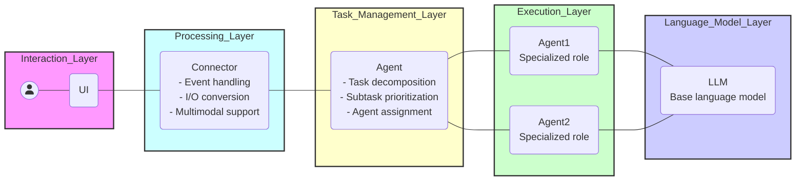
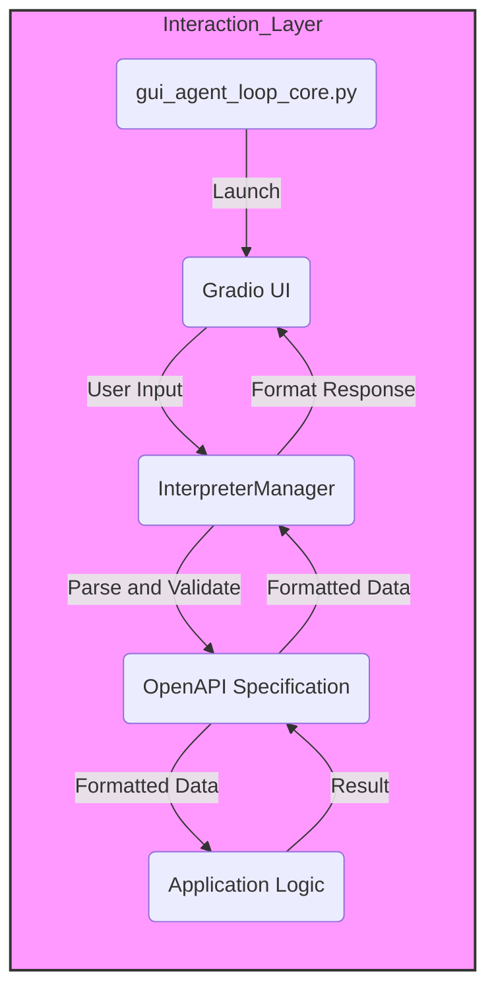

# GuiAgentLoopCore

## Architecture Diagram

### Interaction_Layer - Processing_Layer

## What is GuiAgentLoopCore?

GuiAgentLoopCore provides the core logic for bridging GUI frameworks and LLM agents, managing conversation flow, agent interactions, and state control.

### Core Components

This project is built around the following key concepts (see [GLOSSARY.md](GLOSSARY.md) for detailed definitions):

- **Interpreter**: Manages conversation flow and agent interactions as the central component
- **Agent**: Specialized AI entities with specific roles and implementation types
- **Session**: Unique conversation contexts with message history
- **Message**: Structured communication between users, systems, and agents
- **State**: Represents interpreter execution state (STATE_INIT → STATE_RUNNING → STATE_STOP)
- **Memory**: Conversation history buffer (status: draft - AUTO decisions apply)

### Key Features

- **State Management**: Monotonic state transitions ensure consistent interpreter behavior
- **Multi-Agent Support**: Role-based agents with specialized capabilities
- **Streaming Support**: Unified handling of both sync and async streaming responses
- **Type Safety**: Enumerated types for messages, states, and agents prevent runtime errors
- **AutoChat**: Automatic conversation continuation when in STATE_STOP

## System Invariants

This project enforces strict invariants to ensure system safety and consistency. See [AGENTS.md](AGENTS.md) for complete details.

### Critical Invariants (MUST NEVER violate)

- **INV-STATE-001**: `Interpreter` state transitions are monotonic: `STATE_INIT` → `STATE_RUNNING` → `STATE_STOP`
  - State regression is prohibited (e.g., `STATE_RUNNING` → `STATE_INIT`)
  - Use dedicated methods like `change_state_running()` for transitions
  - State is auto-updated every 3 seconds via timer (INV-STATE-002)

- **INV-MSG-001**: `Message` types must be from enumerated set only: `MESSAGE`, `CODE`, `CONFIRMATION`, `CONSOLE`, `IMAGE`, `FUNCTION`
  - Ensures type safety and prevents unexpected message processing

- **INV-MESSAGE-001**: `Message` history is limited to MAX_MESSAGE_LENGTH=100
  - Prevents memory overflow and ensures consistent performance

- **INV-AUTO-001**: `AutoChat` triggers only when in `STATE_STOP`
  - Prevents automatic interference during execution
  - Maintains user control over the conversation flow

- **INV-STREAM-001**: `StreamWrapper` must support both sync and async
  - Ensures flexible integration capabilities

- **INV-SESSION-001**: `Session` must be identified by unique UUIDs
  - Prevents session collisions and ensures proper authentication

- **INV-AGENT-001**: `Agent` must have defined roles: AGENT_EXECUTOR, LLM_PLANNER, SUPERVISOR, THOUGHT, CREW, OTHER
  - Ensures role-based access control and separation of responsibilities
  - Related AUTO decision: AUTO:Agent.role:classification

- **INV-MEM-001**: Conversation memory maintains maximum 100 messages
  - Limits memory usage and maintains performance
  - Related AUTO decision: AUTO:Memory.limit:100 (provisional)

- **INV-CONNECTOR-001**: `Connector` must implement GuiAgentInterpreterABC interface
  - Ensures interface consistency across different implementations

- **INV-CONVERTER-001**: `Converter` must use MappingRule for structured transformations
  - Guarantees consistent data transformation patterns

- **INV-SESSION-002**: Session tokens are JWT-encoded with HS256 algorithm
  - Ensures secure session identification and verification
  - Related AUTO decision: AUTO:Session.jwt:algorithm_hs256 (provisional)

> **Note**: These invariants are enforced through code review and automated tests. Contributors must ensure their changes respect these constraints. See [CONTRIBUTING.md](CONTRIBUTING.md) for guidelines.

## AUTO Decisions (Provisional Specifications)

This project uses AUTO decisions to resolve ambiguities and establish provisional specifications. These decisions are tracked in `.concept/ambiguities.yml` and may evolve as the project matures.

### Critical AUTO Decisions

#### State Management
- **AUTO:State.lifecycle:monotonic** - State transitions are forward-only (no regression)
- **AUTO:State.transition:auto_on_input** - User input (textbox.submit) automatically transitions to RUNNING
- **AUTO:State.timer:3sec** - State is auto-updated every 3 seconds via Gradio timer

#### Message Handling
- **AUTO:Message.structure:flat** - Messages are recursively flattenable to nested dictionaries
- **AUTO:Message.limit:100** - MAX_MESSAGE_LENGTH=100 is a hard limit (provisional)

#### Agent System
- **AUTO:Agent.role:classification** - Agents are classified by role (AGENT_EXECUTOR, LLM_PLANNER, etc.)
- **AUTO:Agent.type:implementation_property** - AgentType (TOOL_CALLING, STRUCTURED_CHAT) is an implementation property, independent from role

#### AutoChat
- **AUTO:AutoChat.trigger:stop_only** - AutoChat triggers only when in STATE_STOP
- **AUTO:AutoChat.prompt:default_continue** - If AUTO_CHAT_PROMPT env var is not set, uses safe default continuation prompt

#### Backend
- **AUTO:Backend.primary:gradio** - Gradio is the primary backend (provisional)
- **AUTO:Backend.deployment:security** - Backend launches on 0.0.0.0 with allowed_paths security restrictions

#### Memory (Draft Status)
- **AUTO:Memory.window:k10** - Conversation memory uses rolling window of size k=10 (provisional)
- **AUTO:Memory.specs:provisional** - Window size k=10 (rolling) + max length 100 (hard limit) (provisional)

> **Note**: AUTO decisions are marked as "provisional" and may be refined based on further evidence or testing. See [CLAUDE.md](CLAUDE.md) for AI agent-specific guidelines on respecting these decisions.

## Getting Started

### Prerequisites

### Installation

## Usage

* Documentation: <https://nobu007.github.io/GuiAgentLoopCore>
* GitHub: <https://github.com/nobu007/GuiAgentLoopCore>
* PyPI: <https://pypi.org/project/GuiAgentLoopCore/>
* Free software: MIT

## Features

- **Interpreter**: Central component managing chat sessions and state handling
- **Agent System**: Role-based agents (AGENT_EXECUTOR, LLM_PLANNER, SUPERVISOR, THOUGHT, CREW)
- **Message Types**: Structured communication (MESSAGE, CODE, CONFIRMATION, CONSOLE, IMAGE, FUNCTION)
- **State Machine**: Reliable state transitions (INIT → RUNNING → STOP)
- **AutoChat**: Automatic continuation prompts when execution stops
- **StreamWrapper**: Unified sync/async streaming response handling
- **Converter**: Request conversion with dictionary flattening and code content extraction
- **Backend Support**: Gradio-based GUI implementation (with extensible framework support)

> **Note**: This project uses a formal concept dictionary. All documentation uses canonical terminology. See [AGENTS.md](AGENTS.md) for AI agent guidelines and [GLOSSARY.md](GLOSSARY.md) for term definitions.

## Credits

This package was created with [Cookiecutter](https://github.com/audreyr/cookiecutter) and the [waynerv/cookiecutter-pypackage](https://github.com/waynerv/cookiecutter-pypackage) project template.
