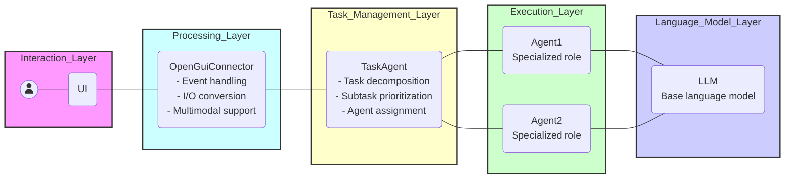
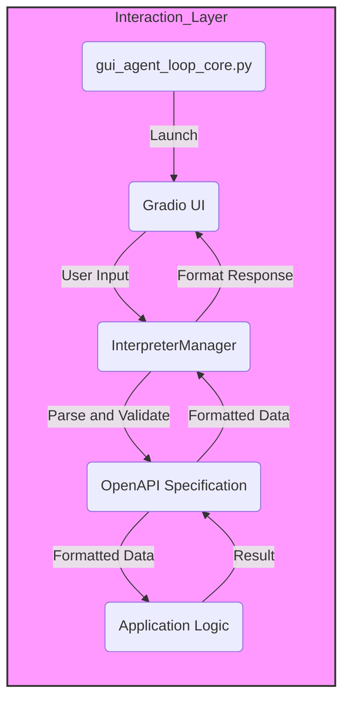

# GuiAgentLoopCore

## Architecture Diagram

### Interaction_Layer - Processing_Layer

## What is GuiAgentLoopCore?

GuiAgentLoopCore provides the core logic for bridging GUI frameworks and LLM agents, managing conversation flow, agent interactions, and state control.

### Core Components

This project is built around the following key concepts (see [GLOSSARY.md](GLOSSARY.md) for detailed definitions):

- **Interpreter**: Manages conversation flow and agent interactions as the central component
- **Agent**: Specialized AI entities with specific roles and implementation types
- **Session**: Unique conversation contexts with message history
- **Message**: Structured communication between users, systems, and agents
- **State**: Represents interpreter execution state (STATE_INIT → STATE_RUNNING → STATE_STOP)

### Key Features

- **State Management**: Monotonic state transitions ensure consistent interpreter behavior
- **Multi-Agent Support**: Role-based agents with specialized capabilities
- **Streaming Support**: Unified handling of both sync and async streaming responses
- **Type Safety**: Enumerated types for messages, states, and agents prevent runtime errors
- **AutoChat**: Automatic conversation continuation when in STATE_STOP

## Getting Started

### Prerequisites

### Installation

## Usage

* Documentation: <https://nobu007.github.io/GuiAgentLoopCore>
* GitHub: <https://github.com/nobu007/GuiAgentLoopCore>
* PyPI: <https://pypi.org/project/GuiAgentLoopCore/>
* Free software: MIT

## Features

- **Interpreter**: Central component managing chat sessions and state handling
- **Agent System**: Role-based agents (AGENT_EXECUTOR, LLM_PLANNER, SUPERVISOR, THOUGHT, CREW)
- **Message Types**: Structured communication (MESSAGE, CODE, CONFIRMATION, CONSOLE, IMAGE, FUNCTION)
- **State Machine**: Reliable state transitions (INIT → RUNNING → STOP)
- **AutoChat**: Automatic continuation prompts when execution stops
- **StreamWrapper**: Unified sync/async streaming response handling
- **Converter**: Request conversion with dictionary flattening and code content extraction
- **Backend Support**: Gradio-based GUI implementation (with extensible framework support)

> **Note**: This project uses a formal concept dictionary. All documentation uses canonical terminology. See [AGENTS.md](AGENTS.md) for AI agent guidelines and [GLOSSARY.md](GLOSSARY.md) for term definitions.

## Credits

This package was created with [Cookiecutter](https://github.com/audreyr/cookiecutter) and the [waynerv/cookiecutter-pypackage](https://github.com/waynerv/cookiecutter-pypackage) project template.
